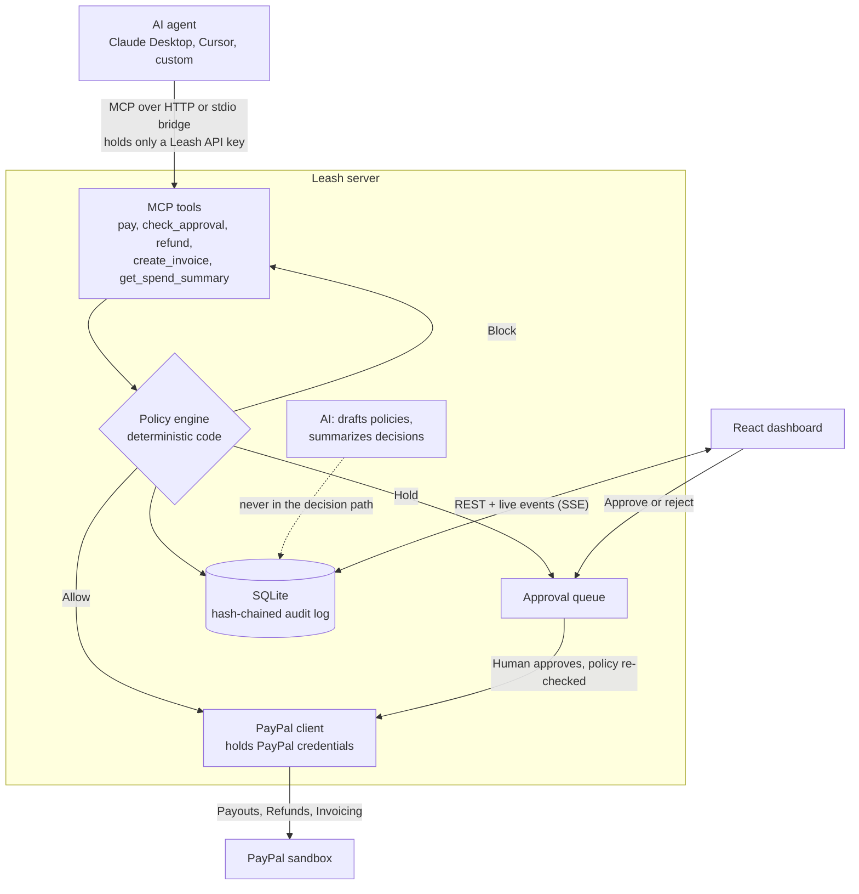

# Leash

**A payment firewall for AI agents.** Leash is an MCP server that sits between any AI agent and PayPal. The agent asks to pay, and plain deterministic code decides whether the payment executes, gets blocked, or waits for a human.

> The AI proposes. The code decides.

Built for the Build What's Next with PayPal and AI hackathon. It runs against the PayPal **sandbox only**, so no real money moves.

## The problem

Agents are starting to buy things, but giving one a payment credential is all or nothing. Once it has the key, a bad prompt, a looping bug or a poisoned web page can spend whatever that key allows. Asking the model to follow a spending limit in its prompt isn't a control, because the thing being limited is the thing enforcing the limit.

Leash moves enforcement out of the model. The agent never holds PayPal credentials. It only gets tools, and every call to those tools goes through a policy engine the agent can't influence.

## What it does

1. **You set the rules**, in a form or in plain English. AI drafts the policy, you review it, and only what you save is enforced.
2. **An agent calls `pay`** over MCP, from Claude Desktop, Cursor or your own code.
3. **Leash decides** in plain code, with no LLM involved:
   - **Allow:** PayPal pays automatically, and the real transaction ID goes back to the agent.
   - **Block:** the agent gets the exact rule that stopped it, so it can adapt.
   - **Hold:** an unsigned cheque appears live on the dashboard, and nothing moves until you approve.
4. **Everything is logged** in a hash-chained, append-only audit trail.

## Architecture



## How PayPal is used

PayPal is the only way money moves in Leash. Every executed action is a real sandbox transaction you can see in the sandbox dashboard.

| Leash action | PayPal API | Notes |
| --- | --- | --- |
| `pay` | Payouts API | Needs no per-payment buyer click, which is what makes autonomous agents possible. Leash polls the item for its final status. |
| `refund` (capture) | Payments API: refund capture | Full or partial. PayPal returns the money to the original payer, so an agent can't redirect it. |
| `refund` (payout) | Payouts API: cancel item | Only for unclaimed payouts. See the limits below. |
| `create_invoice` | Invoicing API | Creates a draft, then sends it. |

## How AI is used

The AI has two real jobs, and neither of them enforces anything.

- **Policy authoring:** "ask me above $20, never more than $45 at once, never for gambling" becomes structured rules. The model's output is validated, and the human reviews it before it counts. Plain code flags any draft that raises a limit or turns off the verified vendors rule, so a misleading instruction can't hide in a long draft.
- **Decision summaries:** blocked and held payments get a short plain-English summary. It's written after the decision is final, and if the AI fails, Leash carries on with the rule's own reason.

The default model is `openai/gpt-oss-120b` on Groq, with structured JSON output. If it reaches its free daily limit, Leash switches to `openai/gpt-oss-20b`. Set `AI_PROVIDER`, `AI_API_KEY` and `AI_MODEL` to configure it. A new provider is one entry in [client.ts](server/src/ai/client.ts).

**Without an AI key, enforcement works exactly the same.** You lose drafting, summaries and the demo agent button.

## Built with

| Tool | What it does in Leash |
| --- | --- |
| PayPal Payouts, Payments and Invoicing APIs (sandbox) | Every payment, refund and invoice. See [How PayPal is used](#how-paypal-is-used). |
| Groq, running `openai/gpt-oss-120b` | Policy drafting, decision summaries and the demo agent. See [How AI is used](#how-ai-is-used). |
| Model Context Protocol (official TypeScript SDK) | How agents connect to Leash's tools, over HTTP or a stdio bridge. |
| AG Grid (sponsor) | The audit log, with sorting, filtering, search and CSV export. See [AuditGrid.tsx](client/src/components/AuditGrid.tsx). |
| Render (sponsor) | Hosts the live demo, deployed from the [render.yaml](render.yaml) blueprint. |
| TypeScript, Node.js, Express, SQLite, React, Vite | The server, storage and dashboard. |
| Claude Code (Claude Opus 5.5) | A coding assistant used while building the project. It isn't part of the running product. |

## Why it's safe to trust

- **Agents never hold PayPal credentials.** The stdio bridge carries only a Leash key.
- **Deterministic engine.** A pure function, with over 180 tests across the project covering exact limits, multiple failures and budget exhaustion.
- **Split payments are caught.** Sending $120 as five $24 payments doesn't work. Leash tracks what each recipient has received in 24 hours, and holds the payment that goes over the limit.
- **Agent claims aren't trusted.** Leash keeps its own vendor records, so labelling a casino as "software" gets blocked.
- **The AI can't be talked into anything.** Agent memos never reach the model, because an agent could use one to steer the summary. Approval cards label the memo as the agent's unverified claim.
- **Human approval can't override a block.** It only clears the approval limits, and the policy is re-checked at approval time.
- **Only a human can approve.** With `DASHBOARD_PASSWORD` set, approvals and policy changes need a password that agents never receive.
- **Unanswered approvals expire.** After 10 minutes a held payment is cancelled, so it can't quietly pay later.
- **No race conditions on budgets.** Checking and reserving share one database transaction, so parallel calls can't both spend the same budget.
- **No double payments.** Retries are safe, and a second click on Approve does nothing.
- **Unknown outcomes stay counted.** If PayPal doesn't confirm a call, the budget stays reserved rather than risk overspending.
- **The record matches PayPal.** If PayPal refunds less than was asked for, Leash records what PayPal actually refunded.
- **Sandbox only.** Leash refuses to start unless `PAYPAL_ENV=sandbox`, and the code contains no live PayPal URL.

## Try it

**Hosted demo:** https://leash-o4p1.onrender.com

Open it, click **Run demo agent**, and approve the payment when its card appears. The dashboard password is `leash-demo`, and the prompt shows it too. The hosted app is shared, so **Reset demo** restores the original rules if someone has changed them, and each run starts with a clean spending slate. The free host sleeps when idle, so the first load can take a minute.

## Run it locally

You need Node.js 22 or newer and a free [PayPal Developer](https://developer.paypal.com) account.

```bash
git clone https://github.com/shreyashtrivedi/Leash
cd Leash
npm run setup
```

Then fill in `.env`:

1. In the PayPal dashboard, open **Testing Tools > Sandbox Accounts** and create a **Business** account in the **United States**. PayPal lists some countries, including India, as receive-only for Payouts.
2. Under **Apps & Credentials**, in Sandbox mode, create an app linked to that account. Turn on **Payouts** and **Invoicing** in its features if you see them.
3. Copy the app's Client ID and Secret into `PAYPAL_CLIENT_ID` and `PAYPAL_CLIENT_SECRET`.
4. Put a sandbox **Personal** account's email in `DEMO_VENDOR_EMAILS`. This makes it a verified vendor.
5. Optional: add a free [Groq](https://console.groq.com) key as `AI_API_KEY` for AI drafting, summaries and the demo agent.
6. Recommended: set `DASHBOARD_PASSWORD`. Without it, anyone who can reach the server can approve payments.

```bash
npm run dev
```

Open http://localhost:5173. The API runs on port 3000.

Run the tests with `npm test`. For a full audit against a running server, `server/scripts/system-check.ts` attacks every rule through real MCP, then checks each transaction with PayPal directly.

## Connect your own agent

Leash must be running first. The sample key is the `LEASH_DEMO_AGENT_KEY` value from your `.env`.

**Claude Desktop** (stdio bridge). Add this to `claude_desktop_config.json`, using your own full path:

```json
{
  "mcpServers": {
    "leash": {
      "command": "node",
      "args": [
        "/full/path/to/leash/node_modules/tsx/dist/cli.mjs",
        "/full/path/to/leash/server/src/mcp/stdio-bridge.ts"
      ],
      "env": {
        "LEASH_URL": "http://localhost:3000/mcp",
        "LEASH_API_KEY": "leash-demo-key"
      }
    }
  }
}
```

**Cursor** (HTTP). Add this to `.cursor/mcp.json`:

```json
{
  "mcpServers": {
    "leash": {
      "url": "http://localhost:3000/mcp",
      "headers": { "Authorization": "Bearer leash-demo-key" }
    }
  }
}
```

The stdio form was tested with Claude Code, and the HTTP form with Claude Code and the official MCP SDK client. Claude Desktop and Cursor use the same two connection types, though they weren't tested directly.

Then ask your agent to pay someone, and watch the dashboard.

### Tools

| Tool | What it does |
| --- | --- |
| `pay` | Send a payment. Returns `executed`, `blocked`, `pending_approval`, `processing` or `failed`, always with a reason. |
| `check_approval` | Get the latest status of an approval or payment. |
| `refund` | Refund a captured payment, or reverse an unclaimed payout. |
| `create_invoice` | Create and send a PayPal invoice. |
| `get_spend_summary` | See remaining budget, spend and the active policy. |

To try `refund`, create a real sandbox capture from the `server` folder, then pass the printed ID as `capture_id`:

```bash
npx tsx scripts/create-test-capture.ts 9.50
```

### The policy

Each agent has its own API key and policy. Set `LEASH_SUPPORT_AGENT_KEY` to connect a second agent as the Support Agent. A policy covers: per-payment cap, auto-approve limit, per-recipient limit over 24 hours, daily and total budgets, allowed or blocked recipients and categories, verified vendors only, payments per hour, and allowed currencies.

| Action | Rules that apply |
| --- | --- |
| Payment | All of them. |
| Refund | Everything except recipient, category and per-recipient rules, because the money can only return to the original payer. |
| Invoice | Everything except budgets, the per-recipient limit and the verified vendors rule, because it requests money rather than spending it. |

## Known limits

- **Claimed payouts can't be refunded.** PayPal documents no API for it, so `refund` says so.
- **Cancelling an unclaimed payout currently fails in the sandbox.** PayPal returns a 500 error, and `refund` reports that honestly. Unclaimed payouts return to the sender after 30 days. Refunds of captured payments work.
- **The dashboard has one shared password, not user accounts.** Everyone with it can approve payments. The hosted demo's password is public so judges can try it, and it only touches the sandbox. A real deployment must set its own, and shouldn't set `DASHBOARD_PASSWORD_HINT`.
- **The per-recipient limit is per agent and per email address.** Splitting across different recipients or agents isn't caught by this rule, though budgets still apply.
- **Budgets count the payment amount, not PayPal's fee.** The sandbox charges $0.25 per payout.
- **Non-USD limits use fixed demo rates.** The demo policies allow USD only.
- **The hash chain is tamper-evident, not tamper-proof.** It detects edits and gaps, but someone who rewrites the whole database and every hash wouldn't be caught.
- **The hosted database resets on restart.** Render's free disk is temporary, so agents and policies re-seed on boot. Each demo run also clears the demo agent's spend counters, and the audit log keeps the history. Entries marked **Sample** are illustrative, have no PayPal IDs and never count towards budgets.
- **The demo agent's task names a preference.** It's told to try the annual plan first, otherwise it reads its limits and skips straight to the cheaper plan. The block that follows is still real, and the agent's code contains no Leash rules. Models vary between runs, so the run summary is built from real results rather than the model's words.
- **Free AI quota.** Groq's free limits are per model and per day, about 200,000 tokens each in our account, which allows roughly 20 demo runs per model. The quota refills gradually rather than all at once, and the smaller backup model doesn't always reach the approval step. When both run out, the demo agent says so and summaries stop, and payments and rules carry on unaffected. Don't put private information in the policy box, because it's sent to the AI provider.

## License

[MIT](LICENSE)
